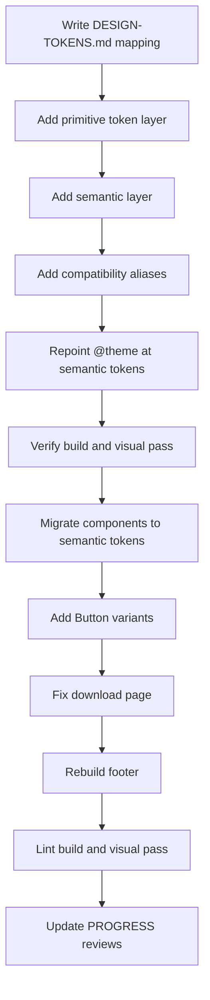

# Design Token Migration Plan — Linear Reference

Source: [`# Design System linear.app.txt`](../%23%20Design%20System%20linear.app.txt)
Target: [`src/app/globals.css`](../src/app/globals.css) token layer + all consumers

---

## 0. Resolved ambiguities

| # | Ambiguity in reference | Decision |
|---|---|---|
| 1 | §2 says Surface `#2E2E32` is the "Main page background", but §6 specs Card `#161718` and the site runs `#08090A` | **Keep `#08090A` as `--bg-surface`.** Reference hexes become the elevated/card ramp layered on top. Least disruption, keeps contrast. |
| 2 | Card border truncated: `1px solid rgba(255` / `255` / `255` / `0.12` | **Interpret as `1px solid rgba(255, 255, 255, 0.12)`** → `--border-card` |
| 3 | Typography/spacing/effects have no token names in the reference; colours and radii do | **Hybrid naming.** Reuse literal reference names where they exist; invent consistent kebab-case for the rest. |

### Known reference defects (documented, not silently fixed)

- §3 typography is internally inconsistent: H1 is `64px` while H2 is `72px`; scale line says `64/24/16`; `H3 20px` and `H4 16px` do not appear in the scale. Rule §7 says "Pair Inter 700 headings" but the specs use weight `510`/`590`.
- §4 says card radius is `12px` in one place and `9px` in the radius vocabulary.
- §5 shadow `medium` is an *inset* ring, not an elevation tier — it is a border, so it is mapped to a border token, not `--shadow-*`.
- §2 lists `--layer-context-menu → 1200` and `--border-hairline → 1px` inside the *colour* section; both are re-homed below.

These get a "reference quirk" callout in the final doc rather than being presented as truth.

---

## 1. Token taxonomy

Four layers, defined in this order inside `@layer base { :root { … } }`:

```
primitives  →  semantic  →  component  →  compatibility aliases
(scale)        (role)        (spec)        (deprecated, point to semantic)
```

### 1.1 Primitives

**Layers** (z-index, from reference)

`--layer-context-menu: 1200` plus a full scale: `--layer-header: 60`, `--layer-tabs: 30`, `--layer-overlay: 1000`

**Radii** (reference literal names)

```
--radius-4: 4px    --radius-6: 6px    --radius-8: 8px
--radius-12: 12px  --radius-16: 16px  --radius-24: 24px
--radius-pill: 9999px
```

**Spacing** (4px grid — reference literal names where present)

```
--space-4 … --space-32 (4,8,12,16,20,24,32)
--page-padding-inline: 24px    --page-padding-block: 64px
--page-padding-left: max(0px, 24px)   --page-padding-right: max(0px, 24px)
--homepage-outer-padding: 46px  --homepage-padding-inset: 32px
--border-hairline: 1px
```

Note: current `.ln-shell` uses `padding-inline: 32px` and `max-width: 1200px`. Plan is to keep `1200px` and expose `32px` as `--homepage-padding-inset`, adding `--page-padding-inline` as the documented default. **Not a breaking change**, because the shell rule is retargeted in the same commit.

**Colour primitives**

```
--color-white: #fff      --color-black: #000      --transparent: #fff0
--color-blue: #4ea7fc    --color-red: #eb5757     --color-green: #27a644
--color-orange: #fc7840  --color-yellow: #f0bf00  --color-indigo: #5e6ad2
--color-teal: #00b8cc
--scrollbar-color: #ffffff1a
--scrollbar-color-hover: #fff3
--scrollbar-color-active: #fff6
--mask-ease: #0003
```

### 1.2 Semantic

**Surfaces** — decision 1 applied (`#08090A` base, reference ramp above it)

| New token | Value | Old token |
|---|---|---|
| `--bg-surface` | `#08090a` | `--ln-bg` |
| `--bg-surface-raised` | `#0f1011` | `--ln-bg-1` |
| `--bg-subtle` | `#141516` | `--ln-bg-2` |
| `--bg-elevated` | `#191a1b` | `--ln-bg-3` |
| `--bg-overlay` | `#1c1d1f` | `--ln-bg-4` |
| `--bg-card` | `#161718` | *(new, from §6)* |
| `--bg-card-elevated` | `#3f3f42` | *(new, from §2 Elevated)* |

**Text**

| New token | Value | Old token |
|---|---|---|
| `--text-primary` | `#f7f8f8` | `--ln-text` |
| `--text-secondary` | `#d0d6e0` | `--ln-text-2` |
| `--text-muted` | `#8a8f98` | `--ln-text-3` |
| `--text-faint` | `#62666d` | `--ln-text-4` |
| `--text-on-primary` | `#08090a` | *(new, button label)* |

**Accent** — reference `Primary #B2D5FF`, `Accent #C1DDFF`

| New token | Value | Old token |
|---|---|---|
| `--accent-primary` | `#b2d5ff` | *(new)* |
| `--accent-primary-hover` | `#c1ddff` | *(new)* |
| `--accent-subtle` | `#c1ddff` | *(new)* |
| `--accent-brand` | `#5e6ad2` | `--ln-accent` |
| `--accent-brand-hover` | `#828fff` | `--ln-accent-hover` |
| `--accent-brand-tint` | `#7170ff` | `--ln-accent-tint` |

**Borders** — [`#ffffff1a`](../src/app/globals.css:2) current hairline

| New token | Value | Old token |
|---|---|---|
| `--border-default` | `#23252a` | `--ln-border` |
| `--border-strong` | `#2c2e33` | `--ln-border-2` |
| `--border-hairline-color` | `#ffffff1a` | `--ln-line` |
| `--border-hairline-soft` | `#ffffff0a` | `--ln-line-soft` |
| `--border-card` | `rgba(255,255,255,0.12)` | *(new, decision 2)* |

> Naming collision to avoid: the reference already uses `--border-hairline` for the **`1px` width**. The colour therefore becomes `--border-hairline-color`. This is called out in the mapping doc so nobody "fixes" it back.

**Shadows** — only two real elevation tiers in the reference

| New token | Value | Old token |
|---|---|---|
| `--shadow-subtle` | `rgba(0,0,0,0.2) 0 0 0 1px` | *(new)* |
| `--shadow-strong` | `rgba(0,0,0,0.25) 0 2px 32px 0` | *(new)* |
| `--ring-inset` | `rgb(35,37,42) 0 0 0 1px inset` | *(new — the "medium" entry)* |

**Typography** — Inter only (reference uses Inter; the site already loads `InterVariable.woff2`)

| New token | Value |
|---|---|
| `--text-h1` / `--text-h1-weight` / `--text-h1-tracking` | `64px` / `510` / `-1.408px` |
| `--text-h2` … | `72px` / `510` / `-1.584px` |
| `--text-h3` … | `20px` / `590` / `-0.24px` |
| `--text-h4` … | `16px` / `590` / `0` |
| `--text-body` / `--text-body-line` | `16px` / `1.5` |
| `--text-lede-line` | `1.6` (§7 rule) |
| `--font-sans` | `"Inter Variable", …` (unchanged behaviour, canonical name) |
| `--font-mono` | `"JetBrains Mono", …` |

**Motion**

| New token | Value | Old token |
|---|---|---|
| `--ease-standard` | `cubic-bezier(.25,.46,.45,.94)` | `--ln-ease` |
| `--ease-out` | `cubic-bezier(.16,1,.3,1)` | `--ln-ease-out` |

### 1.3 Component

```
--button-bg: #e5e5e6        --button-text: #08090a
--button-radius: var(--radius-pill)   --button-weight: 510
--card-bg: var(--bg-card)   --card-border: 1px solid var(--border-card)
--card-radius: var(--radius-12)       --card-shadow: var(--shadow-strong)
--link-color: #ffffff
```

### 1.4 Compatibility aliases

Every old name is re-declared as an alias so **nothing breaks in the same commit**:

```css
/* deprecated — use semantic tokens */
--ln-bg: var(--bg-surface);
--ln-bg-1: var(--bg-surface-raised);
/* … all 20+ --ln-* and --color-* names */
```

Two exceptions where a value genuinely changes and the alias is *not* faithful:
`--ln-text` becomes `#f7f8f8` (was `#f8f8f8`) and `--ln-line` becomes `#ffffff1a` (unchanged).
Both are visually indistinguishable; noted in the breaking-changes table as "cosmetic".

---

## 2. Files in scope

| File | Change |
|---|---|
| [`src/app/globals.css`](src/app/globals.css) | Token layer rewrite; `@theme` alignment; `.ln-footer` rebuild; download asset states |
| [`src/components/ui.tsx`](src/components/ui.tsx) | `Button` → component tokens; `TextLink` → `--accent-primary` |
| [`src/components/site-footer.tsx`](src/components/site-footer.tsx) | New markup to match screenshot |
| [`src/app/download/page.tsx`](src/app/download/page.tsx) | Remove inline styles, use classes; button fixes |
| [`src/app/layout.tsx`](src/app/layout.tsx) | `themeColor` + `bg-ink`/`text-paper` → semantic |
| [`src/app/not-found.tsx`](src/app/not-found.tsx), [`docs/page.tsx`](src/app/docs/page.tsx), [`docs/configuration/page.tsx`](src/app/docs/configuration/page.tsx), [`plugin-sdk/page.tsx`](src/app/plugin-sdk/page.tsx), [`changelog/page.tsx`](src/app/changelog/page.tsx), [`code-block.tsx`](src/components/code-block.tsx) | Migrate `text-paper`/`text-muted`/`text-faint`/`border-line`/`text-ember` utilities to semantic tokens |
| [`src/components/capabilities.tsx`](src/components/capabilities.tsx), [`page-intro.tsx`](src/components/page-intro.tsx), [`releases.tsx`](src/components/releases.tsx), [`syntax.tsx`](src/components/syntax.tsx), [`configuration-section.tsx`](src/components/configuration-section.tsx) | Replace inline `style={{ background: "var(--ln-accent)" }}` with classes |
| `PROGRESS.md`, `REVIEW.md` | Append migration + breaking-change notes |

### Risk: Tailwind v4 `@theme`

`bg-ink`, `text-paper`, `text-muted`, `border-line`, `text-ember` are Tailwind **utilities** generated from an `@theme` block baked into the minified [`globals.css`](src/app/globals.css:1). They are *not* reading `var(--ln-bg)` — the utilities inline the literal. So changing `:root` alone will **not** change `bg-ink`.

Step 6 explicitly re-points `@theme` at the semantic tokens:

```css
@theme inline {
  --color-ink: var(--bg-surface);
  --color-paper: var(--text-primary);
  --color-muted: var(--text-muted);
  --color-faint: var(--text-faint);
  --color-line: var(--border-hairline-color);
  --color-ember: var(--accent-primary);
  --color-signal: var(--text-secondary);
}
```

This is the single highest-risk step and gets a build + visual check on its own.

---

## 3. Download page buttons — what is actually wrong

Reading [`page.tsx`](src/app/download/page.tsx) and the shared [`buttonSkin`](src/components/ui.tsx:103):

1. **Primary CTA is white, reference says `#E5E5E6`.** `buttonSkin` uses `bg-[#f5f5f5]` with `shadow-[inset_0_1px_0_#fff,0_3px_10px_#0002]` and `border-white/70` — three competing treatments. Reference wants flat `#E5E5E6`, text `#08090A`, pill radius, weight `510`.
2. **Hover is ambiguous.** [`globals.css`](src/app/globals.css:5) declares `.ln-btn-primary:hover{background:#e0e2e8}` then immediately `.ln-btn-primary:hover{background:#fff}` — the second wins, so hover *brightens* instead of settling.
3. **No secondary button exists in `ui.tsx`.** Page introduces `<Button>` primary only; asset rows are bare `<a>` with a download glyph, giving three different affordance levels on one screen.
4. **Inline styles fight the class layer.** [`page.tsx`](src/app/download/page.tsx:147) sets `gridTemplateColumns` inline and line 153 sets `fontFamily: "var(--ln-font)"` on an element that also has `ln-mono` — the mono class is applied then overridden.
5. **`pg-asset` hover only changes text colour**, so the whole row does not read as clickable.

### Fix

- Add `variant: "primary" | "secondary" | "ghost"` to `Button`, plus `size` `sm|md|lg`, all driven by `--button-*` tokens.
- Primary = `--button-bg #E5E5E6`, `--button-text #08090A`, `--radius-pill`, weight `510`, hover → `--bg-card-elevated` with `--shadow-subtle`.
- Secondary = transparent, `1px solid var(--border-default)`, text `--text-primary`.
- Asset rows: full-row hover `background: var(--bg-elevated)`, radius `--radius-8`, download glyph `--text-faint → --text-primary`, and a proper `:focus-visible` ring using `--accent-primary`.
- Delete the inline `gridTemplateColumns` / `fontFamily` overrides; move to `.pg-asset--stacked`.

---

## 4. Footer — match [`Screenshot 2026-10-26 121108.png`](public/Screenshot%202026-10-26%20121108.png)

Current footer is a 4-column grid with brand + 3 link columns, no bottom bar.

Target composition, top to bottom:

```
┌──────────────────────────────────────────────────────────────┐
│  [logo] Nex            Product   Developers   Elsewhere       │
│  A keyboard-first      Features      Docs        Releases     │
│  launcher for          Download      Config      Issues       │
│  Windows. Free,        Changelog     Plugin SDK  MIT license  │
│  open source,                        GitHub                   │
│  built in Rust.                                              │
│                                                              │
│  ── hairline ────────────────────────────────────────────    │
│  © 2026 Nex          Status · Privacy · Terms      [GH] [X]  │
└──────────────────────────────────────────────────────────────┘
```

Implementation notes:

- Grid: `1.4fr repeat(3, minmax(0,1fr))`, `column-gap: 48px`, brand column with `max-width: 30ch` description.
- Column headings: `13px / 590`, `--text-primary`, sentence case (not uppercase).
- Links: `13px / 400`, `line-height: 34px`, `--text-muted` → `--text-primary` on hover with `--ease-standard`.
- Bottom bar: `margin-top: 56px`, `padding-top: 24px`, `border-top: 1px solid var(--border-hairline-color)`, `13px`, `--text-faint`.
- All existing `data-testid` attributes must be preserved — they are referenced by tests.

**Note on the screenshot:** the image shows the *reference* footer composition. I will match structure, rhythm, and type scale; I will not copy other-brand marks or link labels. Nex link labels and `data-testid`s stay as they are.

---

## 5. Execution order

Ordered so the build is green at every step. Token layer first, Tailwind `@theme` second and verified alone, then components.



---

## 6. Breaking changes

| Change | Impact | Mitigation |
|---|---|---|
| `--ln-*` / `--color-*` become deprecated aliases | Low — values intact | Aliases kept; removal deferred one release |
| `--border-hairline` now means width `1px`, colour moved to `--border-hairline-color` | Any direct `var(--border-hairline)` used as a colour breaks | No such usage found; grep confirms before edit |
| `@theme` utilities now resolve through `var()` | `bg-ink` etc. change if a token changes | Verified visually per route |
| Primary button palette `#f5f5f5` → `#E5E5E6`, glow shadow removed | Visible on every CTA | Documented; intentional per §6 |
| Heading weights \(510/590\) and tracking \(−1.408/−1.584px\) | Slight typographic shift sitewide | Scoped to `--text-h*` tokens only |

---

## 7. Out of scope

- No new fonts are downloaded. Reference's "Berkeley" code face is mapped to the existing JetBrains Mono; adding a licensed font is a separate decision.
- No component rewrites beyond the download page and footer.
- `.next/` and `.rea/` build artefacts are generated output and are not edited.
